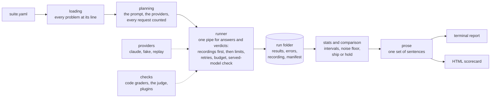

# How Temper fits together

**v1.0 · 10.23.2026**

Temper is a library with a thin command line over it. A run moves through four stages, and every stage writes down what it did before the next one starts.

## The ideas that shape it

**Nothing is spent before the run is planned.** Planning swaps in the run's system prompt, counts every request it will pay for with free calls, and proves the credentials and the models. A budget reserves each request's worst case before it is sent, so a run can stop short of its budget but never pass it. A run that can't start never leaves a folder behind.

**Answers and verdicts go through one pipe.** A judge's verdict is a request like any other: it waits for a slot, keeps to the time limit and the budget, is retried when the API asks, is checked to have come from the model that was asked, and is recorded. Before anything is bought, the run looks in its own recording and in the recording it replays, so a resumed run never pays twice and a replay pays nothing.

**A failure is never a wrong answer.** A timeout, a rate limit, or a crash goes in `errors.jsonl`, never in the score. A cut-off answer, a refusal, and a check that reached no verdict are each labelled and left out of the pass rate, and every report says how many were.

**Every number says how sure it is.** Pass rates come with Wilson intervals and changes with Newcombe's, widened across a suite's cases so one false alarm among forty is as unlikely as one alone. A verdict needs a change beyond noise.

**Text never becomes markup.** The scorecard is built from a small element builder that escapes every piece of text on the way in, loads nothing, and runs nothing.

## Where each piece lives

| Module | Its one job |
|---|---|
| `suite.py`, `loading.py` | The suite format, and YAML read into it with every problem at its line |
| `checks.py`, `graders.py`, `judge.py`, `plugins.py` | Finding a check, the code graders, the judge's prompt and verdict, and checks other packages add |
| `providers/` | Where answers come from: Claude, a scripted fake, and the replay of a recording |
| `planning.py`, `runner.py` | Planning a run, and running it through the one pipe |
| `results.py`, `jsonl.py` | The run folder and its files |
| `stats.py`, `comparison.py` | The intervals, and the ship-or-hold call |
| `labels.py`, `labeling.py`, `calibration.py` | A person's labels, and the judge measured against them |
| `prose.py`, `summary.py`, `markup.py`, `scorecard.py` | The sentences, the terminal report, the HTML builder, and the scorecard |
| `doctor.py`, `demo/`, `cli.py` | The check-up, the recorded story, and the command line |

The [decision notes](https://github.com/lautbzehn/temper/blob/main/docs/adr/README.md) say why each of these choices was made, and what it costs.
